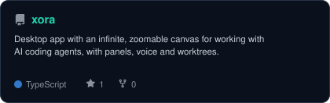
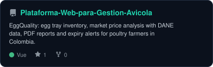
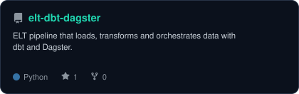
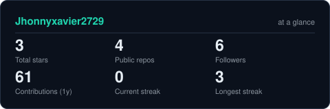

<!-- BANNER - terminal profile.sh --live. Generated by scripts/banner/generate.py.
     ~0.9 MB each. Cache-bust with ?v=N after regenerating. -->
<picture>
  <source media="(prefers-color-scheme: dark)"  srcset="assets/banner-dark.svg?v=1">
  <source media="(prefers-color-scheme: light)" srcset="assets/banner-light.svg?v=1">
  
</picture>

 

<!-- NAME / TAGLINE - animated typing -->

 

<!-- SOCIALS - LinkedIn stays brand blue (its glyph vanishes on custom fills). Others themed. -->
&nbsp;&nbsp;
&nbsp;&nbsp;

 

---

## This is me :)

Hi, I'm **Jhonny**, software developer, broadcasting from Pereira, Colombia 🇨🇴.
I've worked on enterprise projects building and improving web applications, from their
interfaces to their inner workings, and I like turning ideas into real, useful products.

- 💼 **2 years** building and improving web apps for companies, front end to back end.
- 🎓 **Software Analysis and Development Technologist**, now in my **5th semester of Systems Engineering**.
- 🤖 Building **[Xora](https://github.com/Jhonnyxavier2729/xora)**: an infinite canvas to work side by side with AI coding agents.
- 🥚 Shipped **[EggQuality](https://huevoscansena.web.app/)** for small and medium poultry farmers in Colombia.
- 📊 Curious about data engineering: ELT pipelines with **dbt** and **Dagster**.
- 💬 Got an idea, a challenge or an opportunity? **[Let's collaborate](https://jhonny-ramirez-portfolio.vercel.app/#contact)**.
 

## my stack

---

## things I've built

<!-- Repo cards generated by scripts/cards.py from assets/projects.json. -->
<a href="https://github.com/Jhonnyxavier2729/xora">
  <picture>
    <source media="(prefers-color-scheme: dark)"  srcset="assets/card-xora-dark.svg">
    <source media="(prefers-color-scheme: light)" srcset="assets/card-xora-light.svg">
    
  </picture>
</a>
<a href="https://github.com/Jhonnyxavier2729/Plataforma-Web-para-Gestion-Avicola">
  <picture>
    <source media="(prefers-color-scheme: dark)"  srcset="assets/card-Plataforma-Web-para-Gestion-Avicola-dark.svg">
    <source media="(prefers-color-scheme: light)" srcset="assets/card-Plataforma-Web-para-Gestion-Avicola-light.svg">
    
  </picture>
</a>
<a href="https://github.com/Jhonnyxavier2729/elt-dbt-dagster">
  <picture>
    <source media="(prefers-color-scheme: dark)"  srcset="assets/card-elt-dbt-dagster-dark.svg">
    <source media="(prefers-color-scheme: light)" srcset="assets/card-elt-dbt-dagster-light.svg">
    
  </picture>
</a>

---

## Numbers matter? ohhh yes.

<table>
<tr>
<td width="50%" align="center" valign="middle">

<!-- Generated by scripts/cards.py. Deliberately NOT github-readme-stats / streak-stats:
     those are shared public instances that go down and take the whole section with them. -->
<picture>
  <source media="(prefers-color-scheme: dark)"  srcset="assets/card-stats-dark.svg">
  <source media="(prefers-color-scheme: light)" srcset="assets/card-stats-light.svg">
  
</picture>

</td>
<td width="50%" align="center" valign="middle">

<!-- Language mix from real repo byte counts - scripts/radar.py --github -->
<picture>
  <source media="(prefers-color-scheme: dark)"  srcset="assets/radar-langs-dark.svg">
  <source media="(prefers-color-scheme: light)" srcset="assets/radar-langs-light.svg">
  
</picture>

</td>
</tr>
</table>

---

` built with curiosity · Pereira, Colombia `
 
Profile tooling adapted from <a href="https://github.com/emmi-lili/emmi-lili">emmi-lili</a>, thank you for sharing it.

